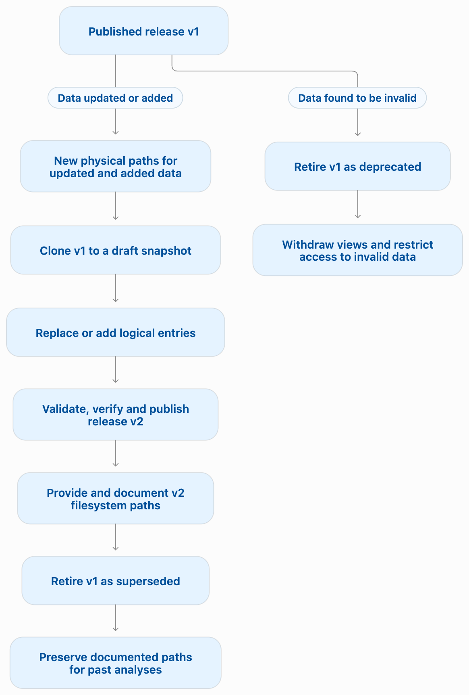

# Omnia administrator and curator guide

This guide is for people who register data, design a logical catalogue tree,
publish snapshots, and operate the local storage and MongoDB connection used by
Omnia.

## Mental model

Omnia separates physical storage from the logical catalogue presented to users.

```text
POSIX/object storage → Dataset records → catalogue → versioned tree snapshot → user view
```

- A **Dataset** records one physical data asset and its metadata.
- A **catalogue** groups related datasets. Separate catalogues may hold
  source and QC data for the same study.
- A **tree snapshot** is a versioned logical hierarchy for one catalogue
  release. Draft snapshots can be modified. Once published, a snapshot's
  logical hierarchy is immutable. A published snapshot is also called a
  **release**.
- A **TreeEntry** is a directory, file, or alias inside a snapshot, identified
  by its logical path.
- A curator-owned **manifest** supplies exclusions, logical renames, roles,
  and scientific metadata for the snapshot.
- **Modality:** a type of data, such as genotypes or phenotypes, assigned
  through curator metadata. Modality labels support filtering during
  discovery and export.

> [!IMPORTANT]
> Use one snapshot for one coherent scientific release. A snapshot can
> contain genotypes, phenotypes, proteomics, and annex files known to belong
> together. When a modality changes, publish a new top-level snapshot rather
> than changing the old one.
>
> Store every new or updated table at a new physical path. Include the
> version date in updated table names, for example `P5070_20261110.csv`,
> and preserve earlier files unchanged.
>
> Publishing freezes the logical hierarchy, not the physical file contents.
> Use `omnia catalogue verify` to compare files with their stored checksums.

## Curator guide overview

- **[Manage catalogues and snapshots](#manage-catalogues-and-snapshots):**
  create catalogues, prepare and inspect draft snapshots, publish updates,
  manage snapshot lifecycles, and verify structure and physical files.
- **[Curator manifest](#curator-manifest):**
  define exclusions, logical renames, roles, and scientific metadata.
  Follow consistent naming and QC versioning conventions.
- **[Provide data access](#provide-data-access):**
  configure storage profiles, provision filesystem views, and document
  the paths researchers should use, including the catalogue and snapshot
  names.
- **[Current security boundary](#current-security-boundary):**
  understand deployment assumptions and enforce access through filesystem
  permissions, storage policy, and the surrounding platform.

## Manage catalogues and snapshots

Snapshots follow this lifecycle:

```text
draft → published → retired
```

- **draft**: may be extended with `tree add-path`, validated, or discarded.
- **published**: immutable; it can be browsed, mounted, and exported.
- **retired**: preserved for provenance but excluded from normal browse results,
  mounts, and exports.

Snapshots are retired when they are superseded by newer versions or
deprecated because their data are no longer approved for use.

> [!IMPORTANT]
> Retiring a snapshot preserves its logical hierarchy and provenance, but
> prevents new mounts. It does not remove existing exported symlink views
> or revoke access to the underlying files.
>
> For superseded snapshots, preserve the documented filesystem views and
> original files so existing analyses can continue to use those paths.
>
> For deprecated snapshots, remove their documented filesystem views and
> restrict access to invalid data through filesystem permissions.

The diagram below summarizes how to publish new snapshots and retire
previous versions.

{ width=75% }

### Create and publish a snapshot

Create the catalogue once, then ingest a physical source directory into a
draft snapshot:

```bash
omnia catalogue create <catalogue-name> --description "Catalogue description"

omnia tree ingest <catalogue-name> <source-path> <snapshot-name> \
  --manifest <manifest-file>
```

Here, `<source-path>` is the physical directory to register, and
`<manifest-file>` is the curator manifest YAML file. See
[Curator manifest](#curator-manifest) for its format.

Use the following `catalogue` command group to manage catalogue records.

Inspect the catalogue's metadata:

```bash
omnia catalogue describe <catalogue-name>
```

If its description needs updating:

```bash
omnia catalogue update <catalogue-name> \
  --description "Updated catalogue description"
```

Review the draft using the commands in
[Inspect a draft snapshot](#inspect-a-draft-snapshot), then validate it:

```bash
omnia tree validate <catalogue-name> <snapshot-name>
```

Check registered physical files against their stored checksums:

```bash
omnia catalogue verify <catalogue-name>
```

> [!IMPORTANT]
> `tree validate` checks structure and dataset references, not physical
> file contents.
>
> `catalogue verify` checks files across the catalogue, not just the new
> snapshot. Resolve relevant issues before publication.

Publish the snapshot after reviewing its contents and validation results:

```bash
omnia tree publish <catalogue-name> <snapshot-name>
```

After publishing a replacement and documenting its access paths, retire
the superseded snapshot:

```bash
omnia tree retire <catalogue-name> <old-snapshot-name> \
  --reason "Superseded by <new-snapshot-name>"
```

Preserve its existing documented views and underlying files. Confirm that
the documented paths remain usable after retirement.

For deprecated data, record the specific problem instead:

```bash
omnia tree retire <catalogue-name> <invalid-snapshot-name> \
  --reason "Deprecated: unreliable time variables"
```

Withdraw access separately, following the policy in
[Manage catalogues and snapshots](#manage-catalogues-and-snapshots).

List all lifecycle records, including drafts and retired snapshots:

```bash
omnia tree list <catalogue-name>
```

If you created an empty catalogue by mistake, you can delete its record.
This is an optional cleanup action, separate from snapshot publication:

```bash
omnia catalogue delete <catalogue-name>
```

> [!NOTE]
> `omnia mkdir`, `omnia mv`, and `omnia rmdir` remain available as legacy
> compatibility commands. New scripts should use `omnia catalogue create`,
> `update`, and `delete`.
>
> `omnia ls` is also a legacy command. Use `omnia catalogue describe` for
> catalogue metadata and `omnia catalogue verify` for checksum verification.

### Inspect a draft snapshot

Before publishing, list the draft's logical entries from its root or inspect a
subdirectory:

```bash
omnia tree ls <catalogue-name> <snapshot-name>
omnia tree ls <catalogue-name> <snapshot-name> phenotypes
```

Use recursive and long output to review descendants and the full curator
metadata attached to entries. JSON output is useful for scripted checks:

```bash
omnia tree ls <catalogue-name> <snapshot-name> \
  --recursive --long --sort path
omnia tree ls <catalogue-name> <snapshot-name> \
  --recursive --long --format json
```

> [!NOTE]
> `omnia tree ls` is read-only and accepts draft snapshots only. Use it
> with `omnia tree validate` before publication. Browse published snapshots
> with `omnia browse ls`.

Discard a draft only when it is no longer wanted:

```bash
omnia tree discard <catalogue-name> <draft-snapshot-name> --yes
```

### Add data before publication

Add a physical file or directory at a specified logical destination while
the snapshot is still a draft. For example, place additional data below
`annex/`.

```bash
omnia tree add-path <catalogue-name> <snapshot-name> \
  <additional-source-path> annex
```

For a directory source, its contents appear below `annex/`. For a single file,
the destination is the exact logical file path. Omnia creates missing logical
parents and rejects path collisions, unsafe paths, and additions to published
or retired snapshots.

### Update one modality in a new snapshot

Published snapshots are immutable. When, for example, phenotypes are updated,
store the new version at a new physical path and preserve the previous
file unchanged.

Clone the current published snapshot into a draft, then replace the
table's logical entry with a reference to the new physical file:

```bash
omnia tree clone <catalogue-name> <old-snapshot-name> \
  <new-snapshot-name>

omnia tree replace-path <catalogue-name> <new-snapshot-name> \
  <new-source-path-phenotypes> phenotypes --manifest <manifest-file>
```

`tree clone` accepts a published source snapshot and creates a draft target
snapshot with copied logical entries, Dataset references, curator metadata, and
manifest provenance. When the source manifest declares a `snapshot`, Omnia
retargets that safeguard and recalculates its checksum for the draft name. It
does not copy physical data bytes.

`tree replace-path` is draft-only. It removes the destination path and all its
logical descendants, then adds the supplied file or directory at the same
logical destination. Unchanged entries elsewhere in the snapshot still point
to the original Dataset records. Metadata on the replaced root is retained;
curate changed descendants through a replacement manifest.

For an additional table, use `tree add-path` in the cloned draft instead.

> [!IMPORTANT]
> Always pass `--manifest` when a replacement changes the logical
> scientific description. Omnia checks it against the post-replacement
> tree and stores it as the new snapshot manifest.
>
> Without a replacement manifest, Omnia clears the copied manifest checksum
> and records that the previous manifest was invalidated. Do not publish
> the draft until its provenance meets your publication policy.

Review the draft, validate its structure, verify registered physical
files, and publish:

```bash
omnia tree ls <catalogue-name> <new-snapshot-name> --recursive --long
omnia tree validate <catalogue-name> <new-snapshot-name>
omnia catalogue verify <catalogue-name>
omnia tree publish <catalogue-name> <new-snapshot-name>
```

After documenting the replacement's access paths, retire the superseded
snapshot:

```bash
omnia tree retire <catalogue-name> <old-snapshot-name> \
  --reason "Superseded by <new-snapshot-name>"
```

Preserve its documented views and underlying files. Follow the policy in
[Manage catalogues and snapshots](#manage-catalogues-and-snapshots).

### Preserve provenance and consistency

Never manually edit `tree_snapshots` or `tree_entries` in MongoDB. Do not
delete a Dataset that is referenced by a tree snapshot: `omnia rm` now refuses
that operation and reports the logical entries that depend on it.

Validate
legacy or externally damaged snapshots with:

```bash
omnia tree validate <catalogue-name> <snapshot-name>
```

Validation reports missing parents, missing alias targets, and deleted Dataset
references. It does not inspect the physical files or compare their current
contents with stored checksums. Use catalogue verification for that check:

```bash
omnia catalogue verify <catalogue-name>
```

When multiple snapshots ingest the exact same physical path, Omnia reuses
its Dataset record, including its checksum, size, and format metadata.
Re-ingesting an unchanged file is therefore efficient.

If a file is modified in place, `tree validate` will not detect it, and a
new snapshot can inherit stale Dataset metadata. `catalogue verify`
compares the current file with the stored checksum and reports a mismatch,
but it is catalogue-wide rather than snapshot-specific.

> [!IMPORTANT]
> Preserve changed file versions at distinct physical paths. A new
> snapshot cannot preserve an earlier data version if its physical files
> have been overwritten. Checksum verification detects differences; it
> does not prevent changes or restore earlier contents.

Published snapshots cannot be repaired in place; publish a corrected
successor snapshot instead.

## Curator manifest

The manifest is YAML and is stored verbatim, with a SHA-256 checksum, in the
published snapshot. It is the small, reviewable description of the scientific
meaning of the tree.

```yaml
catalog: <catalogue-name> # e.g. example-project
snapshot: <snapshot-name> # e.g. source_v1_<date>

exclude:
  - "**/*.log"
  - ".DS_Store"

renames:
  - source: raw_data/phenotypes
    destination: phenotypes
  - source: raw_data/proteome
    destination: proteomics

nodes:
  - path: phenotypes
    role: modality
    metadata:
      modality: phenotype

  - path: proteomics
    role: modality
    metadata:
      modality: proteomics
```

### Manifest fields

| Field                 | Meaning                                                                               |
| --------------------- | ------------------------------------------------------------------------------------- |
| `catalog`, `snapshot` | Optional safeguards that must match the ingest command.                               |
| `exclude`             | Shell-style patterns evaluated against scanned physical-relative paths.               |
| `renames`             | Maps a scanned `source` subtree to a logical `destination` without moving data.       |
| `nodes`               | Annotates a logical path after renaming with a `role` and JSON-compatible `metadata`. |

All manifest paths must be non-empty safe relative paths: no absolute paths and
no `..`. Rename destinations are logical paths. The most-specific matching
rename applies to nested sources. Omnia rejects duplicate rename sources and
logical collisions. Logical aliases are rewritten consistently when their
targets are renamed.

Metadata accepts strings, numbers, booleans, lists, and mappings. `modality`
is currently used by `browse find --modality` and `export-links --modality`;
other metadata remains available through `browse describe` and JSON output.

### Naming and QC strategy

Catalogues group related datasets. Separate catalogues may hold source
and QC data for the same study.

- **Source data:** original files supplied by the data holders.
- **QC data:** data produced through quality checking. The methods can
  differ between datasets.
- **Analysis data:** results produced through analytical processing of
  source or QC data.

Each catalogue contains named snapshots representing versions of its data.
Prefer the following naming conventions for new snapshots:

- `<catalogue-name>_source_YYYYMMDD`
- `<catalogue-name>_qced_YYYYMMDD`
- `<catalogue-name>_analysis_YYYYMMDD`

Use `YYYYMMDD` for the snapshot's publication date.

Keep modality directory names consistent across related snapshots.
For example:

```text
catalogue-name_source_20261001/
├── genotypes/
├── phenotypes/
├── proteomics/
└── annex/
```

Record processing methods, pipeline versions, and input data versions
in curator metadata.

Document the filesystem paths together with the catalogue and snapshot
names. Preserve earlier documented paths when snapshots are superseded.

## Provide data access

### Configure storage profiles and safe data access

Trusted physical roots belong in the administrator-managed Omnia YAML
configuration, not MongoDB and not normal user commands. For a shared/HPC
deployment, keep this file centrally managed and read-only, for example
`/etc/omnia/config.yaml`:

```yaml
default_storage_profile: catalogue-name-shared

storage_profiles:
  catalogue-name-shared:
    storage_roots:
      - /processing/catalogue-name
      - /processing/reference-data
    allowed_catalogs:
      - catalogue-name
```

Administrators provision filesystem views and document the paths
researchers should use, together with the registered catalogue and
snapshot names.

For a FUSE mount, specify where the mounted snapshot should appear:

```bash
omnia --configuration-file /etc/omnia/config.yaml \
  mount <catalogue-name> <snapshot-name> <mount-directory>
```

For a symlink export, specify a new directory that does not already exist:

```bash
omnia --configuration-file /etc/omnia/config.yaml \
  export-links <catalogue-name> <snapshot-name> <export-directory>
```

`allowed_catalogs` prevents accidental use of a profile for the wrong
catalogue. A named profile can be selected when a deployment has more than
one:

```bash
omnia mount <catalogue-name> <snapshot-name> <view-directory> \
  --storage-profile catalogue-name-shared
```

`--storage-root` remains an advanced administrator override for test and
one-off environments. It may be repeated for multiple roots, but it cannot be
combined with `--storage-profile`.

Only files registered in Omnia below the resolved roots are exposed. Paths
outside those roots and physical symbolic links are rejected.

For an HPC shared filesystem without FUSE, materialize a new symlink view:

```bash
omnia export-links <catalogue-name> <snapshot-name> <view-directory>
```

The export destination must not already exist. Exports are created
atomically, and their directories are owner-writable so the view can be
removed. File symlinks reveal and depend on their POSIX targets. Removing
the view's directories and symlinks does not delete the linked data.

> [!IMPORTANT]
> A symlink export does not enforce read-only access to its target files.
> Target filesystem permissions remain the access control mechanism.
>
> Protect published data through permissions on both the original files
> and their containing source directories. Researchers must not be able
> to modify, delete, or replace published data.

A FUSE mount is read-only and avoids exposing target paths in ordinary
directory listings. It does not revoke access through other storage paths.

On macOS, use foreground FUSE operation. macFUSE background forking can fail
because the process may fork after Objective-C threads are active.

### Hand off a published snapshot to users

After publication, provision the filesystem view and update the data
documentation with:

- the registered catalogue and snapshot names;
- the processing stage and a description of the changes;
- the relevant paths within the snapshot;
- the full filesystem paths researchers should use in their analyses;
- the previous snapshot's status and any retirement reason.

Researchers use the documented paths directly.

See [the data user guide](data-user.md).

## Current security boundary

This implementation is appropriate for trusted users and workflow jobs that
already have MongoDB and filesystem access on the relevant host or shared
filesystem. It does not yet provide federated identity, dataset-level Omnia
authorization, or authenticated remote downloads.

> [!IMPORTANT]
> Do not treat a local mount or symlink export as a security boundary.
> Enforce access through POSIX ACLs, storage policy, and the surrounding
> platform.
